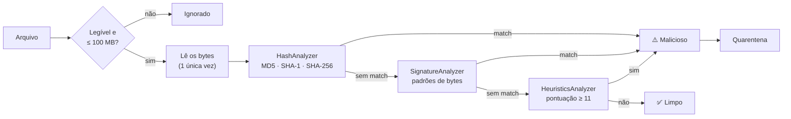

# 🛡️ Classic Antivirus

Antivírus educacional escrito em **Java puro** (sem dependências externas), com interface gráfica em **Swing**, voltado para **Linux/Ubuntu**. Combina três camadas de detecção — **hash**, **assinatura de bytes** e **heurística** — e inclui varredura sob demanda, **monitoramento em tempo real** e **quarentena** com restauração.


> ⚠️ **Projeto educacional.** Ele **não substitui** um antivírus comercial: a base de dados é pequena e a heurística é simples, então pode haver **falsos positivos e falsos negativos**. Não o use como única proteção.

<!-- Adicione capturas de tela em docs/ e descomente:

-->

---

## 📑 Sumário

- [Funcionalidades](#-funcionalidades)
- [Como funciona](#-como-funciona)
- [Tecnologias utilizadas](#-tecnologias-utilizadas)
- [Estrutura do projeto](#-estrutura-do-projeto)
- [Instalação e execução](#-instalação-e-execução)
- [Usando o programa](#-usando-o-programa)
- [Bancos de dados](#-bancos-de-dados)
- [Configuração](#-configuração)
- [Como testar com segurança](#-como-testar-com-segurança)
- [Limitações conhecidas](#-limitações-conhecidas)
- [Ideias para o futuro](#-ideias-para-o-futuro)
- [Contribuindo](#-contribuindo)
- [Licença](#-licença)

---

## ✨ Funcionalidades

| Recurso | Descrição |
|---|---|
| **Scanner** | Varre a Desktop do usuário (ou a home, se ela não existir) e todas as subpastas. |
| **Directory Scanner** | Varredura recursiva de qualquer pasta escolhida em um seletor de arquivos. |
| **Real Time Analyzer** | Monitora `/tmp`, `Downloads` e `Desktop`; analisa arquivos novos ou modificados assim que terminam de ser gravados. |
| **Quarentena** | Move ameaças para uma pasta isolada, sem permissão de execução. Permite **restaurar** ou **apagar** definitivamente. |
| **Detecção em 3 camadas** | Hash (MD5 / SHA-1 / SHA-256), assinaturas de bytes e heurística por pontuação. |
| **Bancos em texto puro** | Hashes, assinaturas e strings suspeitas são arquivos `.txt` fáceis de editar. |
| **Aprendizado simples** | Quando uma assinatura ou a heurística detecta um arquivo, o SHA-256 dele é cadastrado no banco de hashes. |

---

## 🔍 Como funciona

Todo arquivo passa pelo mesmo pipeline, centralizado em `Antivirus.scanFile(caminho)`: o arquivo é lido **uma única vez** e os analisadores rodam em sequência, parando no primeiro que acusar.



### 1. Hash (`HashAnalyzer`)
Calcula **MD5, SHA-1 e SHA-256** do arquivo com `MessageDigest` e procura cada um em `storage/hashdatabase.txt`. A consulta usa um `HashSet` em memória (comparação sem diferenciar maiúsculas/minúsculas), então é O(1) por hash. É a camada mais rápida e a que quase não gera falso positivo — mas só reconhece arquivos **exatamente iguais** aos já conhecidos.

### 2. Assinatura (`SignatureAnalyzer`)
Cada linha de `storage/badsignatures.txt` é uma sequência de bytes em hexadecimal. O analisador converte a linha para `byte[]` e procura esse trecho **dentro do conteúdo** do arquivo, byte a byte. Assinaturas com menos de 4 bytes ou com formato inválido são ignoradas para evitar falsos positivos.

### 3. Heurística (`HeuristicsAnalyzer`)
Extrai todas as sequências de **caracteres ASCII imprimíveis com 5 ou mais caracteres** (como o comando `strings`) e soma pontos:

| Analisador | O que procura | Pontos |
|---|---|---|
| `StringAnalyzer` | Strings **distintas** que contêm termos de `badstrings.txt` (ex.: `backdoor`, `reverse_shell`, `CreateRemoteThread`) | ≥ 3 → **7** · ≥ 10 → **10** |
| `ShellAnalyzer` | Referência a `/bin/sh` ou `/bin/bash` | **4** |
| `NetworkAnalyzer` | `af_inet`, `sock_stream`, `htons`, `inet_addr`, `socket` | **+1 cada** (máx. 5) |
| `DupAnalyzer` | Chamadas `dup2(` (padrão de *reverse shell*: redirecionar stdin/stdout/stderr) | 1–2 → **1** · ≥ 3 → **3** |

Se a soma chegar a **11 pontos**, o arquivo é considerado malicioso. Os termos são comparados sem diferenciar maiúsculas/minúsculas e respeitam fronteira de palavra (`system(` casa em `system(argv)`, mas `systematic` não casa).

### Varredura e tempo real
- **Varredura:** `Files.walkFileTree` percorre as pastas **sem seguir links simbólicos**, continua mesmo quando uma pasta não tem permissão e ignora a própria pasta `storage/` (para não reacusar os arquivos quarentenados).
- **Tempo real:** cada pasta marcada recebe um `RealTimeAnalyzer` em uma thread *daemon* com `WatchService` (inotify no Linux). O monitor espera o arquivo parar de crescer antes de ler (downloads em andamento), ignora `.part`, `.crdownload`, `.tmp` e `.swp`, e não reanalisa o mesmo arquivo se ele não mudou.

### Quarentena (`MoveQuarentine`)
Ao detectar uma ameaça, o arquivo é movido para `storage/quarentine/<UUID>` e as informações ficam em `<UUID>.INFO`:

```
wfound=/home/usuario/Downloads/arquivo.sh
nlocal=/caminho/do/projeto/storage/quarentine/3f2c...-uuid
date=2026-11-22T10:15:30.123
```

- O arquivo quarentenado recebe permissão `rw-------` (sem execução).
- **Restaurar** devolve o arquivo ao local de origem (cria as pastas se preciso). Se já existir algo lá, o arquivo volta como `nome.restored`.
- **Apagar** remove o arquivo e o `.INFO`. Só opera em caminhos **dentro** da pasta de quarentena, então um `.INFO` adulterado não consegue apagar arquivos de fora.

---

## 🧰 Tecnologias utilizadas

| Área | Tecnologia |
|---|---|
| Linguagem | **Java 11+** (testado com OpenJDK 21) |
| Interface gráfica | **Swing** (`JFrame`, `CardLayout`, `JTable`, `JFileChooser`, `JOptionPane`) |
| Concorrência na UI | **`SwingWorker`** para varreduras sem travar a janela; `SwingUtilities.invokeLater` para atualizar a tela a partir de outras threads |
| Monitoramento em tempo real | **`java.nio.file.WatchService`** (inotify no Linux) |
| Percorrer pastas | **`Files.walkFileTree`** + `SimpleFileVisitor` |
| Hashing | **`java.security.MessageDigest`** (MD5, SHA-1, SHA-256) |
| Heurística | `java.util.regex` (com *lookaround* para fronteira de palavra) |
| Estado por thread | **`ThreadLocal`** (caminho e conteúdo do arquivo analisado) |
| Segurança de arquivos | Permissões POSIX (`PosixFilePermissions`) na quarentena |
| Modularização | **JPMS** (`module-info.java`, módulo `ClassicAV` requer `java.desktop`) |
| Persistência | Arquivos de texto (`.txt`) — sem banco de dados |
| Build | `javac` puro — **sem Maven/Gradle e sem bibliotecas externas** |

---

## 📂 Estrutura do projeto

```
Classic_Antivirus/
├── module-info.java
├── core/                          # Lógica do antivírus (sem dependência de interface)
│   ├── Antivirus.java             #   Classe base, leitura única do arquivo e scanFile()
│   ├── HashAnalyzer.java          #   Camada 1: hashes
│   ├── SignatureAnalyzer.java     #   Camada 2: assinaturas de bytes
│   ├── HeuristicsAnalyzer.java    #   Camada 3: heurística por pontuação
│   ├── Scanner.java               #   Varredura recursiva de pastas
│   ├── DoScan.java                #   Fachada usada pela interface
│   ├── RealTimeAnalyzer.java      #   Monitor em tempo real (WatchService)
│   ├── MoveQuarentine.java        #   Quarentena: mover, listar, restaurar, apagar
│   ├── AddHash.java               #   Cálculo e gravação de hashes
│   ├── UploadFile.java            #   Cadastra o hash de um arquivo detectado
│   ├── ScanLogger.java            #   Callback de log da varredura
│   └── ThreatListener.java        #   Callback de ameaça/erro do tempo real
├── storage/
│   ├── AppPaths.java              #   Todos os caminhos (Desktop, Downloads, storage...)
│   ├── getdb.java                 #   Leitura dos bancos com cache
│   ├── hashdatabase.txt           #   Hashes de malwares conhecidos
│   ├── badsignatures.txt          #   Assinaturas de bytes (hex)
│   ├── badstrings.txt             #   Strings suspeitas da heurística
│   └── quarentine/                #   Criada automaticamente na primeira quarentena
└── ui/
    ├── Exec.java                  #   Ponto de entrada (main)
    ├── AVFrame.java               #   Janela principal
    └── resource/                  #   Ícones
```

A separação em três pacotes mantém o núcleo (`core`) independente da interface (`ui`): dá para reaproveitar os analisadores em uma versão de linha de comando, por exemplo.

---

## 🚀 Instalação e execução

### Requisitos
- Linux (desenvolvido e testado para **Ubuntu**)
- **JDK 11 ou superior** com suporte gráfico

```bash
sudo apt update
sudo apt install default-jdk      # NÃO use os pacotes "-headless": eles não têm interface gráfica
java -version                     # confirme que é 11 ou superior
```

### Compilar e executar

```bash
git clone https://github.com/jdavidbrandao/Classic_Antivirus.git
cd Classic_Antivirus

javac -d out $(find . -name "*.java")
java -cp out:. ui.Exec
```

> Execute **da raiz do projeto**: é de lá que o programa lê a pasta `storage/` e os ícones (`ui/resource`).

### Usando uma IDE (Eclipse / IntelliJ / VS Code)
Importe como projeto Java, marque a raiz do repositório como pasta de código-fonte (para os ícones ficarem no *classpath*) e execute `ui.Exec`.

---

## 🖥️ Usando o programa

O menu lateral tem cinco telas:

1. **Scanner** — botão *Scan my Computer*: varre a Desktop do usuário; uma janela mostra cada arquivo sendo analisado.
2. **Directory Scanner** — botão *Scan Directory*: escolha qualquer pasta; as subpastas também são analisadas.
3. **Real Time Analyzer** — marque `Temp`, `Downloads` e/ou `Desktop` e clique em **Start**. Ao detectar algo, o arquivo vai direto para a quarentena e um aviso aparece. **Stop** encerra o monitoramento.
4. **Quarantine** — lista tudo que está isolado. Selecione uma linha e use **Restore** ou **Delete**.
5. **About** — resumo das funções.

Após cada varredura, uma janela de resumo mostra quantas ameaças foram encontradas e quais foram (ou **não** puderam ser) movidas para a quarentena.

---

## 🗃️ Bancos de dados

Todos ficam em `storage/`, em texto puro, **uma entrada por linha**. Linhas em branco e linhas iniciadas com `#` são ignoradas. As alterações são recarregadas automaticamente quando o arquivo muda.

| Arquivo | Conteúdo | Exemplo |
|---|---|---|
| `hashdatabase.txt` | Hashes em hexadecimal (MD5 = 32 caracteres, SHA-1 = 40, SHA-256 = 64) | `8b05f7d1…25de` |
| `badsignatures.txt` | Sequências de bytes em hexadecimal (comprimento par, mínimo de 4 bytes) | `6E9CFA5BC91D999F…` |
| `badstrings.txt` | Termos que a heurística procura nas strings do arquivo | `reverse_shell` |

Para gerar o SHA-256 de um arquivo e cadastrá-lo:

```bash
sha256sum arquivo-suspeito                                        # só para ver o hash
sha256sum arquivo-suspeito | cut -d' ' -f1 >> storage/hashdatabase.txt   # cadastra
```

> 💡 Evite termos muito genéricos em `badstrings.txt` (como `scan`, `send`, `move`): eles aparecem em qualquer documento e geram falsos positivos.

---

## ⚙️ Configuração

Nada é obrigatório, mas dá para ajustar:

| O quê | Como |
|---|---|
| Pasta `storage/` (bancos e quarentena) | `java -Dclassicav.storage=/caminho/para/storage -cp out:. ui.Exec` |
| Pasta varrida por *Scan my Computer* | Altere `AppPaths.defaultScanDir()` em `storage/AppPaths.java` |
| Pontuação mínima da heurística | Constante `THRESHOLD` em `HeuristicsAnalyzer.java` (padrão: 11) |
| Tamanho máximo analisado | Constante `MAX_SCAN_BYTES` em `Antivirus.java` (padrão: 100 MB) |

As pastas **Desktop** e **Downloads** são descobertas pelo arquivo `~/.config/user-dirs.dirs` (padrão XDG), então funcionam com nomes traduzidos, como *Área de Trabalho*. Se o arquivo não existir, o programa tenta os nomes comuns (`Desktop`, `Downloads`, etc.) dentro da home.

---

## 🧪 Como testar com segurança

Você **não precisa de malware de verdade**. Os testes abaixo usam arquivos de texto inofensivos.

**Teste da heurística** — cria um arquivo de texto com termos suspeitos suficientes para atingir 11 pontos:

```bash
cd ~/Desktop
for w in virus payload backdoor reverse_shell bindshell shellcode dropper exploit keycap netcat ncat nmap; do
  echo "xx $w xx"
done > teste-suspeito.txt
echo "/bin/sh -i" >> teste-suspeito.txt
```

Rode o **Scanner** (ou ative o **Real Time Analyzer** com *Desktop* marcado *antes* de criar o arquivo). O arquivo deve ir para a quarentena, e dali você pode restaurá-lo ou apagá-lo.

**Teste de hash** — qualquer arquivo seu pode virar "malware conhecido":

```bash
echo "arquivo de teste" > ~/Desktop/qualquer.txt
sha256sum ~/Desktop/qualquer.txt | cut -d' ' -f1 >> storage/hashdatabase.txt
```

Escaneie a pasta: o arquivo será detectado pelo hash. (Depois, remova a linha do `hashdatabase.txt`.)

---

## 🚧 Limitações conhecidas

- **Não é um antivírus de produção.** Base de dados pequena e heurística baseada em strings: sujeita a falsos positivos (ex.: um *script* legítimo que use `/bin/bash` e várias palavras da lista) e a falsos negativos (malware ofuscado, empacotado ou criptografado).
- **O tempo real age depois da gravação.** Ele não intercepta a execução de um arquivo; apenas analisa e isola o arquivo logo que ele aparece ou é modificado.
- **Monitoramento não recursivo.** No tempo real, só o nível principal de cada pasta (`/tmp`, `Downloads`, `Desktop`) é observado, não as subpastas. A varredura manual, sim, é recursiva.
- **Arquivos acima de 100 MB são ignorados** (para evitar estouro de memória, já que o arquivo é lido inteiro).
- **Não analisa processos em memória**, e não abre arquivos compactados (`.zip`, `.tar.gz`…) para olhar o conteúdo.
- **Aprendizado automático:** quando a assinatura ou a heurística detecta um arquivo, o hash dele entra no banco. Um falso positivo, portanto, passa a ser reconhecido como malware conhecido até você remover a linha de `hashdatabase.txt`.
- Foco em **Linux**. Nos demais sistemas, os caminhos de Desktop/Downloads podem precisar de ajuste em `AppPaths`.
